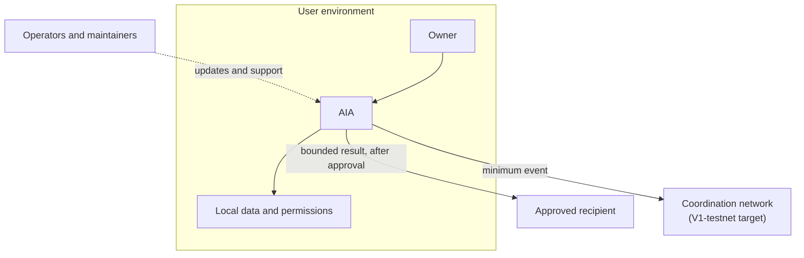

# Privacy and security

SENEX starts from a local-first boundary: personal context should remain within the user-controlled environment unless the user approves a specific use or exchange. The goal is not merely to move storage onto a device, but to make data flows purposeful, limited, visible, and revocable.

:::info Working foundation
Local context handling, encrypted local storage, sealed wallet keys, and governed sharing between owners are implemented in AIA for the scope in [Current status](../status.md). They reduce unnecessary central collection, but they are not a formal privacy guarantee or security certification.
:::

## Public privacy model

SENEX organizes privacy around four questions:

1. **Where does information begin?** Personal context begins inside the user-controlled environment.
2. **Why is it being used?** Access should be tied to an understandable user purpose.
3. **What crosses a boundary?** Only the minimum information needed for an approved task should be exchanged.
4. **How does control end?** Continuing access should be reviewable and revocable.

This model covers raw content and derived information. A summary, classification, or recommendation can still reveal sensitive facts, so derived results should receive the same purpose and scope review as their sources.

## Trust boundaries

- **User environment:** AIA, local data, device access, and user permissions. Security here also depends on the device, operating system, backups, credentials, and user configuration.
- **Approved recipient:** another participant or service that receives a bounded result. SENEX cannot make a recipient forget information already disclosed, so approval must precede transfer.
- **Coordination network:** [V1-testnet](../concepts.md#v1-testnet) should receive only the information required to coordinate and account for an event, not unrestricted personal context.
- **Operators and maintainers:** software updates, support processes, and operational access require their own controls and review.

See [Privacy controls and technology direction](technologies.md) for the capability-level control framework and the [Security threat model](threat_model.md) for the risks considered.

## Status boundaries

:::caution V1-testnet target
Network privacy behavior is a V1-testnet target. V1-testnet will use test-only ASHA and is not a live public blockchain or production privacy service. Its purpose is to expose design and operational failures before V1.
:::

Protections enforced today include encrypted local storage, wallet keys sealed by default, private file permissions, and a hardened local API; see [Current status](../status.md). Advanced collaboration protections remain a [research direction](mathematical_guarantees.md). Public docs do not claim that formal privacy properties, secure collective computation, or anonymity guarantees are currently implemented.

## Assurance, not slogans

Privacy claims should be tied to evidence: documented data flows, observable permission behavior, repeatable tests, issue handling, and independent review. "Local," "encrypted," or "decentralized" are not complete security conclusions on their own.

:::warning External validation required
Independent assessment is required for privacy boundaries, authorization, software updates, network behavior, and any future formal claim. See [Compliance and responsible data use](compliance.md) for legal and regulatory limits. SENEX does not currently claim certification under a privacy, security, healthcare, or financial standard.
:::

Implementation-specific cryptography, internal interfaces, thresholds, infrastructure choices, and exploitable operating details are intentionally excluded from public documentation.

## Related pages

- [Privacy controls and technology direction](technologies.md)
- [Privacy assurance and evidence](mathematical_guarantees.md)
- [Security threat model](threat_model.md)
- [Compliance and responsible data use](compliance.md)
